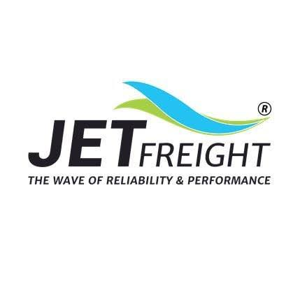
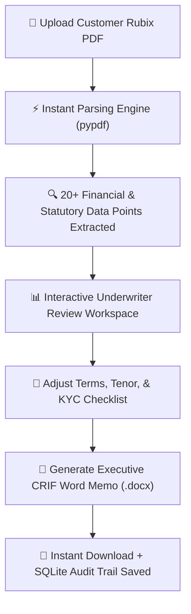

<div align="center">
  

  # Jet Freight Logistics — Credit Control Portal
  
  **Automated Credit Risk Underwriting & Executive Memorandum Generation System**
  
  <p align="center">
    
    
    
    
    
    
  </p>

  <p align="center">
    <i>An intelligent workflow tool built for commercial credit underwriters, sales executives, and financial directors at Jet Freight Logistics Limited.</i>
  </p>
</div>

---

## 📖 What Does This Application Do?

When new corporate shippers or exporters apply for credit terms (e.g., 30 days to pay air/ocean freight invoices), underwriters must analyze complex 15-page **Rubix Business Check** credit bureau reports.

Manually reading these PDFs, verifying statutory compliance (GST delays, PF filings, court litigation), calculating exposure limits, and typing up a formal **Credit Appraisal Memorandum (CRIF)** takes **45–60 minutes per customer**.

### **With This Portal:**
1. **Drop the PDF:** The underwriting engine extracts corporate identity, financial scores, GST/PF delays, and bureau-suggested limits in **under 2 seconds**.
2. **Review & Adjust:** Underwriters verify credit tenor (e.g. 21 days for IATA Air, 30 days for Ocean), assign the Sales Executive, and confirm statutory KYC documents.
3. **One-Click Download:** Compiles an executive, audit-ready **Word Memorandum (`.docx`)** with official Jet Freight headers, high-resolution company branding, and digital sign-off blocks.
4. **Audit Trail:** Automatically records all sanctioned limits in a searchable, paginated ledger with zero manual data entry.

---

## ⚡ How It Works (Visual Flow)



---

## 🚀 Quick Start (Running Locally)

### Prerequisites
Make sure you have installed on your computer:
* **Python 3.10+** ([Download Python](https://www.python.org/downloads/))
* **Node.js 18+** ([Download Node.js](https://nodejs.org/))

---

### Option A: 1-Click Launch (Recommended)
Open your terminal inside this folder and run:

```bash
./run.sh
```

This single command starts both servers automatically:
* 🌐 **Web Interface:** [http://localhost:3000](http://localhost:3000)
* ⚙️ **Backend API & Swagger Docs:** [http://localhost:8001/docs](http://localhost:8001/docs)

---

### Option B: Docker Compose (Local or EC2)
Launch the complete containerized stack (FastAPI backend + Nginx reverse proxy serving built React assets):

```bash
docker compose up -d --build
```

Access the portal directly at [http://localhost](http://localhost) (Port 80).

---

### Option C: Step-by-Step Manual Launch

#### 1. Start the Backend API (Python)
```bash
# Optional: create and activate a virtual environment
python3 -m venv backend/venv
source backend/venv/bin/activate  # On Windows: backend\venv\Scripts\activate

# Install backend dependencies (only 5 lightweight packages)
pip install -r backend/requirements.txt

# Start the API server
python3 -m uvicorn backend.app.main:app --host 127.0.0.1 --port 8001
```

#### 2. Start the Frontend Dashboard (React + Vite)
Open a second terminal window:
```bash
cd frontend
npm install
npm run dev -- --port 3000
```
Open your browser to `http://localhost:3000`.

---

## 🎯 Key Capabilities & Business Features

| Feature | Description | Business Benefit |
| :--- | :--- | :--- |
| **Instant Extraction** | Pulls Legal Name, Constitution, Incorporation Date, Address, and Risk Grades (`Rx1` to `Rx7`). | Eliminates human manual data-entry errors. |
| **Statutory Risk Alerts** | Detects PF filing delays (>30 days) and High Court litigation records with visible alert banners. | Flags high-risk debtor companies before credit exposure is sanctioned. |
| **Commercial Tenor Rules** | Enforces CASS Air Freight limits (15–21 days) and Customs Duty terms at 0 Days (COD / Advance). | Protects operating cash flow against airline and customs liabilities. |
| **Branded `.docx` Builder** | Generates Word documents styled in Jet Freight Navy (`#1E3A8A`) with embedded logos and KYC tables. | Ready for immediate submission to Directors and Board Credit Committees. |
| **Audit Ledger & Records** | Searchable history table with non-blocking deferred search, format badges, and paginated records. | Complete historical audit trail for internal compliance. |
| **Automatic Retention** | Auto-purges uploaded temporary PDFs after **3 hours** and generated DOCX memos weekly (**7 days**). | Zero disk clutter; compliant with data privacy best practices. |

---

## 📂 Project Structure & Architecture

```text
jfll-credit-control-portal/
├── .github/workflows/
│   └── deploy.yml             # Automated CI/CD pipeline for AWS Free Tier
├── backend/
│   ├── app/
│   │   ├── main.py            # FastAPI endpoints, security headers, cleanup worker
│   │   ├── models.py          # Pydantic schemas (KYC, Extraction, Memo requests)
│   │   ├── parser.py          # Deterministic Rubix PDF text & regex extractor
│   │   ├── generator.py       # Custom XML-formatted Word document (.docx) builder
│   │   ├── database.py        # SQLite connection manager, WAL mode, B-Tree indexes
│   │   └── s3_storage.py      # Seamless AWS S3 synchronization for DB & documents
│   ├── requirements.txt       # Core Python dependencies
│   ├── requirements-lambda.txt# Stripped dependencies for AWS Lambda serverless
│   ├── Dockerfile             # Production Python container (non-root appuser)
│   ├── storage/
│   │   ├── memos/             # Generated CRIF memoranda (.docx) [Auto-purged weekly]
│   │   └── uploads/           # Ephemeral uploaded PDFs [Auto-purged every 3 hours]
│   └── tests/
│       ├── fixtures/          # Anonymized sample test PDFs
│       ├── test_pipeline.py   # 13 comprehensive unit & API integration tests
│       └── test_aws_integration.py # 3 AWS Lambda & S3 fallback integration tests
│
├── frontend/
│   ├── src/
│   │   ├── App.tsx            # Main application layout, state & keyboard shortcuts
│   │   ├── config/api.ts      # Cloud-aware API configuration helper
│   │   ├── components/
│   │   │   ├── Navbar.tsx            # Corporate navigation header & tab switcher
│   │   │   ├── FileUpload.tsx        # Drag-and-drop PDF dropzone
│   │   │   ├── MetricCards.tsx       # 4-box key metric overview with live inline edit
│   │   │   ├── MemoForm.tsx          # Multi-section underwriting & KYC checklist form
│   │   │   └── AppraisalHistory.tsx  # Paginated audit trail with deferred search
│   │   └── types.ts           # Shared TypeScript interfaces
│   ├── Dockerfile             # Multi-stage production build with Nginx
│   ├── package.json           # React 18, Vite, Lucide Icons, Tailwind CSS
│   └── vite.config.ts         # Fast HMR Vite development server
│
├── nginx/
│   └── default.conf           # Reverse proxy routing /api/ and serving static SPA
├── docs/
│   └── AWS_DEPLOYMENT_GUIDE.md# Complete step-by-step AWS Free Tier setup walkthrough
├── lambda_handler.py          # Mangum serverless entrypoint for AWS Lambda
├── docker-compose.yml         # Container orchestration for local / EC2 deployment
├── jfll-logo.jpeg             # Jet Freight Logistics official corporate emblem
├── run.sh                     # 1-click startup automation script
├── .dockerignore              # Clean container build exclusions
├── .gitignore                 # Enterprise-grade exclusions for clean GitHub repository
└── README.md                  # This documentation guide
```

---

## ☁️ AWS Free Tier Deployment ($0/month)

This application is built for **100% Free Tier deployment** using AWS Serverless services:
* **Frontend:** Amazon S3 + Amazon CloudFront (Always Free: 1TB transfer, 10M requests)
* **Backend:** AWS Lambda via Mangum ASGI adapter (Always Free: 1M requests, 3.2M sec compute)
* **Persistence:** Amazon S3 for `appraisals.db` snapshots & generated CAM memos

👉 **Read the complete step-by-step guide:** [`docs/AWS_DEPLOYMENT_GUIDE.md`](./docs/AWS_DEPLOYMENT_GUIDE.md)

---

## 🔒 Security & Data Privacy

* **Zero Hardcoded Secrets:** No API keys, passwords, or cloud tokens exist in the source code.
* **Strict Upload Sanitization:** Every uploaded file is verified for `%PDF-` magic bytes and capped at 25MB before processing.
* **Path Traversal Defense:** Sanitizes all customer names using strict alphanumeric regex rules, preventing directory traversal.
* **SQL Injection Immunity:** 100% of SQLite database operations use parameterized queries (`?`).
* **HTTP Security Headers:** Responses include `X-Frame-Options: DENY`, `X-Content-Type-Options: nosniff`, and `Strict-Transport-Security`.
* **Configurable CORS:** Default allows local development; can be locked down via the `ALLOWED_ORIGINS` environment variable in production.

---

## 🧪 Running Automated Tests

Run the full automated test suite (verifying PDF parsing, Word generation, SQLite concurrency, and API contracts):

```bash
python3 -m unittest discover backend/tests -v
```

Expected output:
```text
Ran 16 tests in 3.52s — OK
```

---

## 🌐 Production Environment Configuration

When deploying to Docker, AWS Lambda, or an enterprise cloud provider, the application supports standard environment variables:

| Variable | Default | Purpose |
| :--- | :--- | :--- |
| `AWS_REGION` | `ap-southeast-2` | AWS Region for S3 and Lambda resources |
| `S3_DATA_BUCKET` | *(optional)* | S3 bucket name for persistent DB snapshots & memos |
| `S3_FRONTEND_BUCKET` | *(optional)* | S3 bucket for React static assets |
| `LAMBDA_FUNCTION_NAME`| `jfll-credit-portal-api` | AWS Lambda function name |
| `CLOUDFRONT_DISTRIBUTION_ID` | *(optional)* | CloudFront distribution ID for cache invalidation |
| `VITE_API_BASE_URL` | *(empty)* | Base URL for API (empty when routed through CloudFront / Nginx) |
| `ALLOWED_ORIGINS` | `*` | Comma-separated list of allowed domains (e.g. `https://credit.jetfreight.com`) |
| `STORAGE_DIR` | `backend/storage` | Directory for local file storage (`/tmp` in Lambda) |

---

<div align="center">
  <sub>Built for the <strong>Credit Risk & Control Department</strong> at <strong>Jet Freight Logistics Limited</strong>.</sub>
</div>
