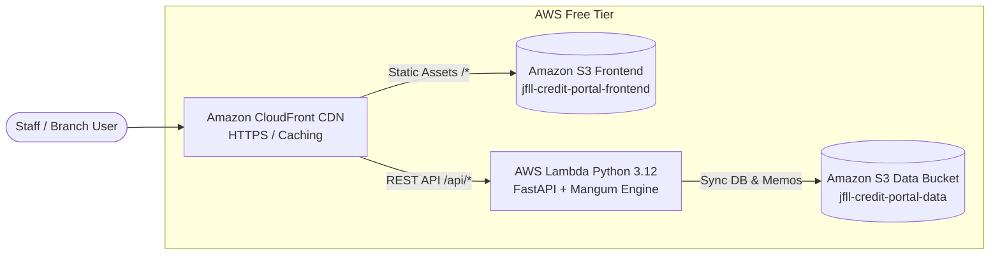

# 🚀 AWS Free Tier Deployment Guide — Jet Freight Logistics Credit Control Portal

This guide provides a comprehensive, step-by-step walkthrough for deploying the **JFLL Credit Control Portal** under the **AWS Free Tier** ($0 monthly cost) with full automated **CI/CD via GitHub Actions**.

---

## 📋 Architecture Overview

The application is architected to run seamlessly on either **Serverless (Recommended)** or **Containerized EC2**, matching Jet Freight Logistics cloud deployment patterns (e.g. *Lead Sourcing Tool*, *Air Cargo Pricing Engine*, *Booking Experience Hub*).

### Recommended Architecture: AWS Serverless (S3 + CloudFront + Lambda)



### Free Tier Safeguards & Zero-Cost Breakdown

| AWS Service | Free Tier Allocation | Credit Portal Usage | Monthly Cost |
| :--- | :--- | :--- | :--- |
| **AWS Lambda** | **1,000,000 requests/mo** + 3.2M sec compute | ~5,000 requests/mo | **$0.00** (Always Free) |
| **Amazon CloudFront** | **1 TB data transfer** + 10,000,000 HTTPS req/mo | < 2 GB / mo | **$0.00** (Always Free) |
| **Amazon S3** | **5 GB Standard Storage** + 20,000 GETs | < 500 MB (SPAs + Memos) | **$0.00** (Free 12 mo) |
| **CloudWatch Logs** | **5 GB ingestion/storage** | < 100 MB with 14-day retention | **$0.00** (Always Free) |

---

## 🛠️ Step-by-Step Serverless Setup (AWS Console)

### Step 1: Create the Amazon S3 Buckets

We need two S3 buckets:
1. **Frontend Bucket:** `jfll-credit-portal-frontend` (stores the compiled React SPA)
2. **Data Bucket:** `jfll-credit-portal-data` (stores encrypted SQLite database snapshots & generated CAM `.docx` files)

1. Open the [Amazon S3 Console](https://s3.console.aws.amazon.com/s3/).
2. Click **Create bucket**:
   - **Bucket name:** `jfll-credit-portal-frontend` (or a globally unique name like `jfll-credit-frontend-yourname`)
   - **AWS Region:** Select your preferred region (e.g., `ap-southeast-2` Sydney or `ap-south-1` Mumbai)
   - **Block Public Access:** Keep **all blocked** (CloudFront will access it privately via Origin Access Control).
   - Click **Create bucket**.
3. Repeat for the Data bucket:
   - **Bucket name:** `jfll-credit-portal-data`
   - **Block Public Access:** Keep **all blocked** (strictly private).
   - Click **Create bucket**.

---

### Step 2: Create IAM User & Permissions for GitHub Actions

Create an unprivileged IAM user for GitHub Actions CI/CD deployment:

1. Open the [IAM Console](https://us-east-1.console.aws.amazon.com/iam/home#/users).
2. Click **Users** → **Create user**:
   - **User name:** `github-actions-credit-portal`
3. Click **Next** → Select **Attach policies directly**.
4. Click **Create policy** → Choose **JSON** tab and paste the following scoped policy:

```json
{
  "Version": "2012-10-17",
  "Statement": [
    {
      "Sid": "LambdaDeploy",
      "Effect": "Allow",
      "Action": [
        "lambda:GetFunction",
        "lambda:UpdateFunctionCode",
        "lambda:UpdateFunctionConfiguration",
        "lambda:PublishVersion"
      ],
      "Resource": "arn:aws:lambda:*:*:function:jfll-credit-portal-api*"
    },
    {
      "Sid": "S3Deploy",
      "Effect": "Allow",
      "Action": [
        "s3:PutObject",
        "s3:GetObject",
        "s3:ListBucket",
        "s3:DeleteObject"
      ],
      "Resource": [
        "arn:aws:s3:::jfll-credit-portal-frontend*",
        "arn:aws:s3:::jfll-credit-portal-data*"
      ]
    },
    {
      "Sid": "CloudFrontInvalidation",
      "Effect": "Allow",
      "Action": [
        "cloudfront:CreateInvalidation",
        "cloudfront:GetInvalidation"
      ],
      "Resource": "*"
    }
  ]
}
```

5. Name the policy `JFLLCreditPortalDeploymentPolicy` and click **Create policy**.
6. Attach this policy to `github-actions-credit-portal`.
7. Click the user → **Security credentials** tab → **Create access key** (Select *Application running outside AWS*).
8. **Save the Access Key ID and Secret Access Key** (you will add these to GitHub Secrets).

---

### Step 3: Create the AWS Lambda Backend Function

1. Open the [AWS Lambda Console](https://console.aws.amazon.com/lambda/).
2. Click **Create function**:
   - **Function name:** `jfll-credit-portal-api`
   - **Runtime:** `Python 3.12` (or `Python 3.11`)
   - **Architecture:** `x86_64`
3. Expand **Change default execution role**:
   - Select **Create a new role with basic Lambda permissions**.
4. Click **Create function**.
5. Once created:
   - Go to the **Configuration** tab → **General configuration** → **Edit**:
     - **Memory:** `512 MB` (Fast execution & quick cold start)
     - **Timeout:** `30 seconds`
     - Click **Save**.
   - Go to **Configuration** → **Environment variables** → **Edit**:
     - Add `S3_DATA_BUCKET` = `jfll-credit-portal-data`
     - Add `ALLOWED_ORIGINS` = `*`
     - Add `AWS_REGION` = `ap-southeast-2` (or your chosen region)
     - Click **Save**.
   - Go to **Configuration** → **Function URL**:
     - Click **Create function URL**.
     - **Auth type:** `NONE` (Public REST endpoint).
     - Check **Configure cross-origin resource sharing (CORS)**:
       - **Allow origin:** `*`
       - **Allow methods:** `GET`, `POST`, `OPTIONS`
       - **Allow headers:** `*`
     - Click **Save**.
   - Go to **Configuration** → **Permissions**:
     - Click the Execution role name to open IAM.
     - Click **Add permissions** → **Attach policies** → attach `AmazonS3FullAccess` (or a scoped policy allowing read/write to `jfll-credit-portal-data`).

---

### Step 4: Configure CloudFront CDN Distribution (Optional but Recommended)

CloudFront provides a free custom SSL domain (`https://xxxx.cloudfront.net`), global edge caching, and routes both frontend static assets and backend API through a single origin address.

1. Open the [CloudFront Console](https://console.aws.amazon.com/cloudfront/).
2. Click **Create distribution**:
   - **Origin domain:** Select `jfll-credit-portal-frontend.s3.amazonaws.com`
   - **Origin access:** Select **Origin access control settings (recommended)** → Create new OAC.
   - **Default root object:** `index.html`
3. Under **Viewer protocol policy:** Select **Redirect HTTP to HTTPS**.
4. Under **Cache key and origin requests:** Select `CachingOptimized`.
5. Click **Create distribution**.
6. After creation:
   - Go to the **Error pages** tab:
     - Click **Create custom error response**:
     - **HTTP error code:** `403: Forbidden`
     - **Customize error response:** Yes
     - **Response page path:** `/index.html`
     - **HTTP response code:** `200: OK`
     - (Repeat for `404: Not Found`). *This ensures React client-side routing works on page refreshes.*
7. *(Optional)* Add a second origin pointing to the Lambda Function URL:
   - Go to **Origins** → **Create origin** → Paste your Lambda Function URL domain (`xxxx.lambda-url.ap-southeast-2.on.aws`).
   - Go to **Behaviors** → **Create behavior**:
     - **Path pattern:** `/api/*`
     - **Origin:** Select the Lambda origin
     - **Viewer protocol policy:** Redirect HTTP to HTTPS
     - **Allowed HTTP methods:** `GET, HEAD, OPTIONS, PUT, POST, PATCH, DELETE`
     - **Cache policy:** `CachingDisabled`

---

## 🔐 Step 5: Configure GitHub Secrets & Variables

In your GitHub repository:
1. Navigate to **Settings** → **Secrets and variables** → **Actions**.
2. Under the **Secrets** tab, add:

| Secret Name | Value | Purpose |
| :--- | :--- | :--- |
| `AWS_ACCESS_KEY_ID` | `AKIA...` | IAM user access key from Step 2 |
| `AWS_SECRET_ACCESS_KEY` | `wJalrX...` | IAM user secret key from Step 2 |

3. Under the **Variables** tab (or Secrets), add:

| Variable Name | Example Value | Notes |
| :--- | :--- | :--- |
| `AWS_REGION` | `ap-southeast-2` | Your AWS region |
| `LAMBDA_FUNCTION_NAME` | `jfll-credit-portal-api` | Lambda function name from Step 3 |
| `S3_FRONTEND_BUCKET` | `jfll-credit-portal-frontend` | S3 bucket for React build |
| `S3_DATA_BUCKET` | `jfll-credit-portal-data` | S3 bucket for SQLite DB & memos |
| `CLOUDFRONT_DISTRIBUTION_ID` | `E1A2B3C4D5E6F7` | Optional: CloudFront distribution ID |
| `VITE_API_BASE_URL` | `https://xxxx.lambda-url...` | Optional: Only needed if not using CloudFront `/api/*` routing |

---

## 🚀 Step 6: Deploy!

Simply push a commit to `main`:

```bash
git add .
git commit -m "feat: configure AWS serverless deployment pipeline"
git push origin main
```

Or trigger manually:
1. Go to **Actions** tab in GitHub.
2. Select **Deploy JFLL Credit Portal to AWS Free Tier**.
3. Click **Run workflow** on `main`.

---

## 🐳 Alternative Deployment: EC2 Free Tier with Docker Compose

If you prefer running a dedicated virtual machine instead of Serverless:

1. Launch an **EC2 `t2.micro`** (or `t3.micro`) instance running **Amazon Linux 2023** or **Ubuntu 22.04 LTS** (750 hours/month Free Tier).
2. Assign a Security Group with ports `22` (SSH), `80` (HTTP), and `443` (HTTPS) open.
3. SSH into the instance:
   ```bash
   ssh -i your-key.pem ec2-user@<EC2-PUBLIC-IP>
   ```
4. Install Docker & Compose:
   ```bash
   sudo dnf install -y docker git
   sudo systemctl enable --now docker
   sudo usermod -aG docker ec2-user
   # Exit and reconnect to refresh user group
   ```
5. Clone and start with Docker Compose:
   ```bash
   git clone https://github.com/DevAI-DeepakJFLL/jfll-credit-control-portal-.git
   cd jfll-credit-control-portal-
   docker compose up -d --build
   ```
6. The app will be live at `http://<EC2-PUBLIC-IP>/` with Nginx reverse proxying to FastAPI!

---

## 🛡️ Cost Safeguards & Budget Alerts

To guarantee $0 accidental spend:
1. Open the [AWS Budgets Console](https://console.aws.amazon.com/billing/home#/budgets).
2. Click **Create budget** → Select **Zero spend budget**.
3. Set your email address. AWS will email you immediately if any resource generates even $0.01 in charges.
4. Set CloudWatch Log Group retention to **14 days**:
   - Go to CloudWatch → Log groups → `/aws/lambda/jfll-credit-portal-api` → **Actions** → **Edit retention setting** → `14 days`.
